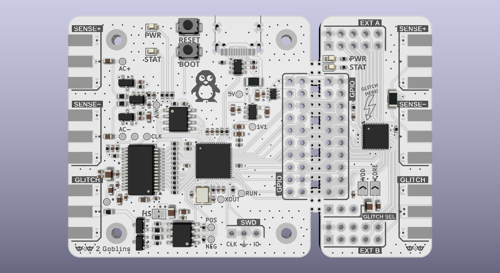
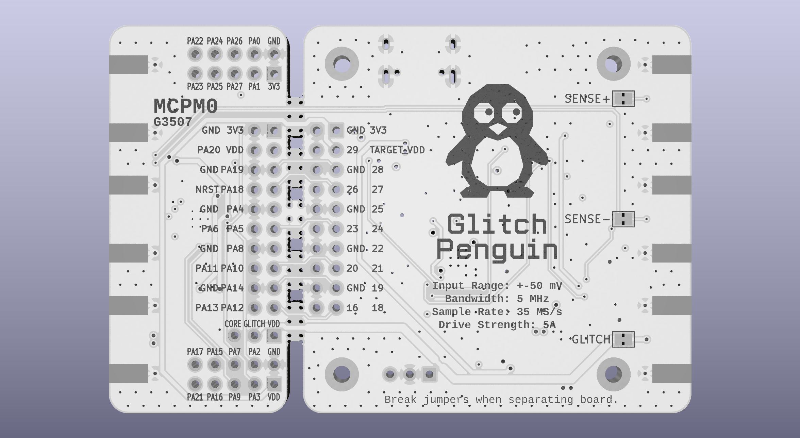

# Glitch Penguin 🐧
> **Glitch Penguin is a low cost all in one platform for fault injection and side channel attacks.**

There are many great products out there for learning about and performing fault injection and side channel attacks (see [NewAE](https://www.newae.com/), [PicoGlitcher](https://fault-injection-library.readthedocs.io/en/latest/overview/)) but their cost can make the barier to entry high especially for a large group environment such as a classroom. Glitch Penguin is a cost optimized glitching platform with a target price of only $10 a board. (We are currently at ~$16 per board using JLCPCB for board manufactuaring and assembly plus US tariffs)

## Highlights
- Powered by the [RP2040](https://www.raspberrypi.com/products/rp2040/)
- Fully open-source hardware and firmware
- Integrated 10bit 35MSPS ADC with AC coupled input range of +/-50mV
- Frontend bandwidth of 5 MHz
- SMA connectors for differnatial sense and glitch output
- Integrated [MCPMOG3507](https://www.ti.com/product/MSPM0G3507) target